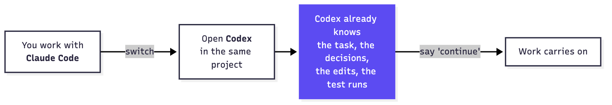
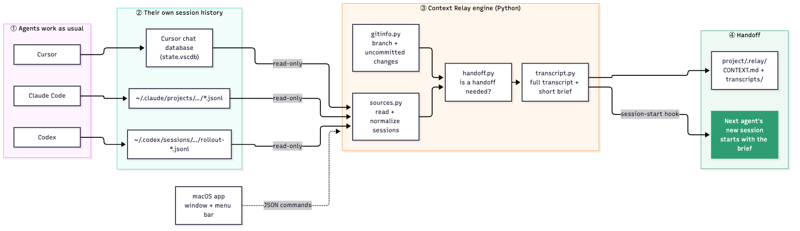
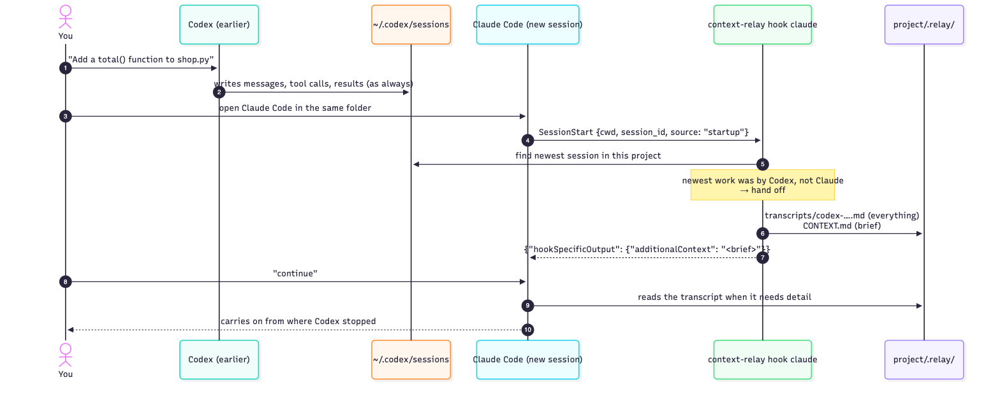
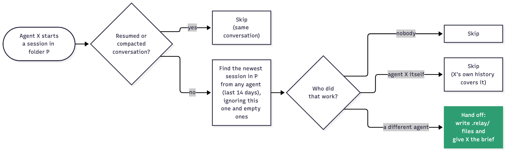
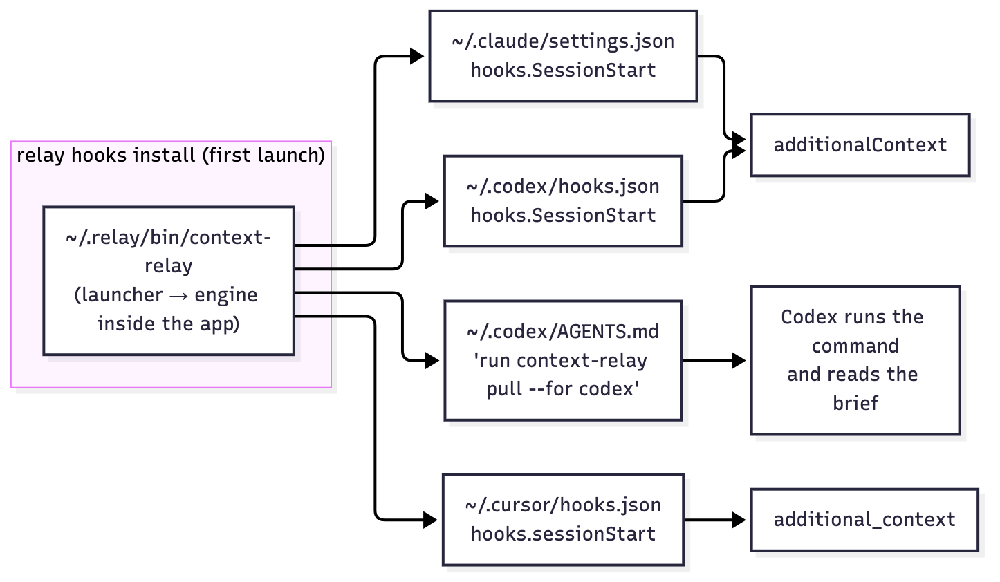

<div align="center">

# ⟳ Context Relay

**Switch between Claude Code, Codex and Cursor mid-task without re-explaining anything.**

Context Relay reads the session history your coding agents already keep on your Mac. When you
open a *different* agent in a project, that agent starts with the previous one's full
conversation: every message, reasoning step, tool call and tool result, plus the live Git state.


-blue)


</div>

---

## Contents

- [Why](#why)
- [What it looks like](#what-it-looks-like)
- [Install](#install)
- [Using it](#using-it)
- [How it works](#how-it-works)
  - [Big picture](#big-picture)
  - [What happens when you switch agents](#what-happens-when-you-switch-agents)
  - [When does a handoff happen?](#when-does-a-handoff-happen)
  - [Reading each agent's history](#reading-each-agents-history)
  - [How context reaches each agent](#how-context-reaches-each-agent)
  - [The handoff files](#the-handoff-files)
- [Repository layout](#repository-layout)
- [CLI reference](#cli-reference)
- [Development](#development)
- [Privacy and safety](#privacy-and-safety)
- [Known limitations](#known-limitations)
- [Contributing](#contributing) · [License](#license)

---

## Why

You hit a rate limit in Claude Code, want Cursor's editor for a refactor, or want Codex to review
something. Every switch means re-explaining the task, what was tried, what was decided and what is
left. Context Relay removes that step. There is nothing to save, write or copy.



## What it looks like

- **App window.** Recent projects, which agent touched each one last, and one-click
  **Continue in Claude Code / Codex / Cursor**. The auto-handoff switch sits at the top.
- **Menu bar (⟳).** The same actions, always one click away.
- **Inside the agents.** No UI at all: a new session simply starts with the previous agent's context.

## Install

### Requirements

| | |
|---|---|
| macOS | 13 Ventura or later. Apple Silicon or Intel (universal app) |
| Python | `/usr/bin/python3`, from Apple's Command Line Tools: `xcode-select --install` |
| Git | Used to read the working tree state (also installed with the Command Line Tools) |
| Agents | Any of [Claude Code](https://docs.claude.com/en/docs/claude-code), [Codex CLI](https://github.com/openai/codex), [Cursor](https://cursor.com) |

The engine uses only the Python standard library, so there is no `pip install` step for the app.

### Build from source

```sh
git clone https://github.com/<you>/context-relay.git
cd context-relay
scripts/build-app.sh                         # → dist/Context Relay.app and dist/ContextRelay.zip
cp -R "dist/Context Relay.app" ~/Applications/
open ~/Applications/"Context Relay.app"
```

`build-app.sh` only needs the Command Line Tools (`swiftc`, `lipo`, `iconutil`, `codesign`), not
a full Xcode install. It produces an ad-hoc signed, universal (arm64 + x86_64) app bundle with the
Python engine inside.

### Install a prebuilt zip

```sh
mkdir -p ~/Applications
ditto -x -k ContextRelay.zip ~/Applications
open ~/Applications/"Context Relay.app"
```

> The app is ad-hoc signed, not notarized. If you download the zip with a browser, macOS
> quarantines it and refuses to open it. Either download it with `curl` (as above), or run
> `xattr -dr com.apple.quarantine ~/Applications/"Context Relay.app"` once.

### First launch

On first launch the app turns on **auto-handoff**. It adds one session-start hook to each agent's
user settings (details in [How context reaches each agent](#how-context-reaches-each-agent)).
Turn it off at any time from the window or the menu bar. That removes only Context Relay's entries.

> **Codex reviews new hooks.** The next time you start Codex in a terminal, it asks you to
> review the Context Relay hook. Approve it. Context Relay also leaves a short instruction in
> `~/.codex/AGENTS.md`, so Codex picks up handoffs even where that review never appears (for
> example when another app drives Codex).

### CLI only (optional)

```sh
pip install .        # installs the `relay` command
relay hooks install
```

## Using it

### Automatic: just switch

1. Work in a project with any agent.
2. Open a **different** agent in the same project folder.
3. Say **"continue"**, or ask "what were we doing?".

| Agent you open | What it receives | How |
|---|---|---|
| Claude Code | Handoff brief, automatically at session start | `SessionStart` hook |
| Codex | Handoff brief, automatically | `SessionStart` hook, or the `AGENTS.md` instruction, where Codex runs one `pull` command |
| Cursor | Handoff brief, automatically | `sessionStart` hook, plus an always-applied rule file written by "Continue in Cursor" |

### One click: Continue in…

| Button | What happens |
|---|---|
| **Continue in Claude Code** | Opens Terminal in the project, running `claude "Continue where Codex left off…"` |
| **Continue in Codex** | Opens Terminal in the project, running `codex "Continue where Claude Code left off…"` |
| **Continue in Cursor** | Opens the project in Cursor and fills its chat with the continue prompt (press Return). The prompt is also copied to your clipboard. |

### Remote setups (for example T3 Code over a tunnel)

If you drive a Mac remotely, you can't see that Mac's window or menu bar. Auto-handoff still works,
because it runs inside the agents. `relay ui` serves the same window as a web page on
`localhost:47821` for when you can reach that port.

## How it works

### Big picture



There are three layers. (The engine also includes `hooks.py`, which installs the session-start
hooks, `launch.py`, which opens agents, and `web.py`, which serves `relay ui`.)

1. **Agents** keep working exactly as before. Context Relay only *reads* their history.
2. **The engine** is a small Python package. It turns any agent's session into one normalized
   event stream, decides whether a handoff is needed, writes it into the project, and formats the
   reply each agent's hook expects.
3. **Front ends**: a native macOS app (window and menu bar) and an optional local web page. Both
   are thin shells over the engine's JSON commands.

### What happens when you switch agents



In a live test, a fresh Claude Code session with **no tools enabled** correctly described the
function Codex had just added, using only the injected brief.

### When does a handoff happen?



The **Continue in…** buttons skip the "same agent" check, because you asked explicitly.

### Reading each agent's history

Each reader converts its agent's native format into the same `Event` stream:
`user`, `assistant`, `thinking`, `tool_call` and `tool_result`.

| Agent | Where | Format | Notes |
|---|---|---|---|
| Claude Code | `~/.claude/projects/<path-slug>/<session>.jsonl` | JSONL, one message block per line | Skips sub-agent side chains and meta messages. Strips `<system-reminder>` blocks |
| Codex | `~/.codex/sessions/YYYY/MM/DD/rollout-*.jsonl` | JSONL `response_item` records | Skips internal reviewer sub-agent sessions and injected `<environment_context>` / AGENTS.md text |
| Cursor | `…/Cursor/User/workspaceStorage/*/state.vscdb` → `globalStorage/state.vscdb` | SQLite key/value (`composerData:*`, `bubbleId:*`) | Reads a **private copy** of the DB so Cursor's live database is never locked |
| Cursor (newer) | `~/.cursor/projects/<slug>/agent-transcripts/*` | text / JSONL | Best-effort reader |

Text that Context Relay itself injected is wrapped in `<context-relay>…</context-relay>` and removed
on export, so handoffs never nest inside each other.

### How context reaches each agent



- **Your entries are untouched.** Context Relay recognizes its own hook entries by the launcher
  path and edits nothing else. Each config file is backed up once (`*.relay-backup`).
- **The launcher stays current.** The app reinstalls the launcher at every start, so moving the
  app doesn't break the hooks. The launcher sets `PYTHONDONTWRITEBYTECODE=1` so the signed bundle
  stays unmodified.
- **Hooks never fail the agent.** The hook always exits 0, and problems go to
  `~/.relay/logs/hook.log`.

### The handoff files

```
your-project/
└── .relay/                     ← ignored by Git automatically (.relay/.gitignore = "*")
    ├── CONTEXT.md              ← the brief (≤ 9,000 chars, fits hook output limits)
    └── transcripts/
        └── codex-20261013-1615-01a13454.md   ← the complete session, nothing summarized away
```

| | Brief (`CONTEXT.md`, injected) | Transcript (`transcripts/*.md`) |
|---|---|---|
| Purpose | Orient the new agent instantly | Every detail, read on demand |
| Contents | Original request and latest user messages · the agent's todo list · files it edited · its last message · branch and uncommitted changes · path to the transcript | Every user and assistant message, reasoning summary, tool call (with arguments) and tool result, in order |
| Size | Capped at 9,000 characters | Unlimited |

## Repository layout

```
context-relay/
├── context_relay/          Python engine (stdlib only)
│   ├── sources.py          Claude Code / Codex / Cursor session readers → Event stream
│   ├── transcript.py       Full Markdown transcript + size-capped brief, todos, edited files
│   ├── handoff.py          Handoff decision, .relay/ writing, project list for the UI
│   ├── gitinfo.py          Branch, HEAD, uncommitted changes (tolerates non-git folders)
│   ├── hooks.py            Install/remove hooks + Codex AGENTS.md block, launcher script
│   ├── launch.py           Open Terminal (claude/codex) or Cursor with a prompt deeplink
│   ├── web.py, ui.html     `relay ui`: the window as a local web page
│   └── cli.py              `relay` command (also what the app and hooks call)
├── app/                    macOS app (Swift, AppKit + SwiftUI)
│   ├── AppDelegate.swift   Window, menu bar item, actions, first-run hook setup
│   ├── MainWindow.swift    SwiftUI window
│   ├── MenuBuilder.swift   Menu model as pure functions (unit-testable)
│   ├── Engine.swift        Runs the Python engine off the main thread, decodes JSON
│   ├── Models.swift        Codable types for the engine's JSON contract
│   └── main.swift          Entry point + --self-test / --snapshot modes
├── scripts/
│   ├── build-app.sh        Universal .app + zip, using only the Command Line Tools
│   ├── make-icon.swift     Draws the app icon
│   └── render-diagrams.sh  Renders docs/diagrams/*.mmd → PNGs for this README
├── docs/diagrams/          Diagram sources (.mmd) and rendered images (.png)
├── tests/test_relay.py     End-to-end tests against fake agent stores
└── pyproject.toml
```

### App ↔ engine contract

The app never parses agent files itself. It shells out to the engine and decodes JSON:

| Command | Returns |
|---|---|
| `relay status --json` | `{hooks: {claude, codex, cursor}, projects: [{path, name, last_agent, last_active, branch, changed_files, sessions[]}]}` |
| `relay continue <agent> --project P --json` | `{ok, from_agent, transcript, context, launched}` |
| `relay hooks install\|uninstall\|status --json` | `{ok, hooks: {…}}` |

## CLI reference

```sh
relay status                          # recent projects and which agent worked on them
relay sessions [--project P]          # sessions in a project, from all agents
relay continue <claude|codex|cursor>  # hand off the latest session and open the agent
relay context --for <agent>           # print the brief (and write .relay/)
relay pull --for <agent>              # for a running agent: fetch its handoff, if any
relay hooks install|uninstall|status
relay ui [--port 47821]               # the window as a local web page
```

## Development

```sh
python3 -m unittest discover -s tests -v     # engine: 22 end-to-end tests
scripts/build-app.sh                         # app bundle + zip

# App checks without clicking anything:
APP="dist/Context Relay.app/Contents/MacOS/ContextRelay"
PYTHONPATH="dist/Context Relay.app/Contents/Resources/engine" python3 -m context_relay status --json > /tmp/s.json
"$APP" --self-test /tmp/s.json           # prints the menu structure
"$APP" --snapshot /tmp/s.json out.png    # renders the window to a PNG
```

**Diagrams:** the README's diagrams are PNGs rendered from the Mermaid sources in
`docs/diagrams/*.mmd`, so they show up everywhere, including GitHub mobile, IDE previews and
package sites. After editing a `.mmd` file, run `scripts/render-diagrams.sh` (needs Node.js).

The tests build fake Claude Code, Codex and Cursor stores (including a real SQLite Cursor DB) in a
temporary `HOME`. They then run the real CLI and cover:
- discovery
- handoff rules
- hook output formats
- nesting protection
- size limits
- install/uninstall preserving user config
- the Cursor deeplink

## Privacy and safety

- **Local only.** No network calls and no telemetry. Session data never leaves your machine
  unless *you* commit or share `.relay/`.
- **Read-only access to agent history.** Cursor's database is read from a temporary copy.
- **Handoffs stay out of Git.** `.relay/` ignores itself, so transcripts aren't committed by accident.
- **Reversible config changes.** Only Context Relay's own entries are edited, and backups are kept.
- **Loopback-only web UI.** `relay ui` binds to `127.0.0.1` / `::1`, and its file endpoint only
  serves Markdown files inside `.relay/` folders.

## Known limitations

- **macOS only** for the app and launch features. The engine itself is plain Python.
- **Cursor** support is built from Cursor's storage format and covered by tests with a synthetic
  database. Cursor changes its internals often, so reports with real data are welcome.
- **Cursor prompt deeplinks** pre-fill the chat but never auto-send, which is Cursor's design. Some
  Cursor versions reject certain prompt text, which is why the prompt is plain words and also
  copied to the clipboard.
- **Codex hook review:** Codex only runs hooks you have reviewed in its terminal UI. The
  `AGENTS.md` instruction covers other cases.
- **Brief size:** the injected brief is capped at 9,000 characters (hook limits). The full detail
  is always in the transcript file.

## Contributing

Issues and pull requests are welcome, especially:
- readers for more agents
- Cursor format updates
- Linux support for the engine

Please run the test suite before opening a PR.

## License

[MIT](LICENSE)
